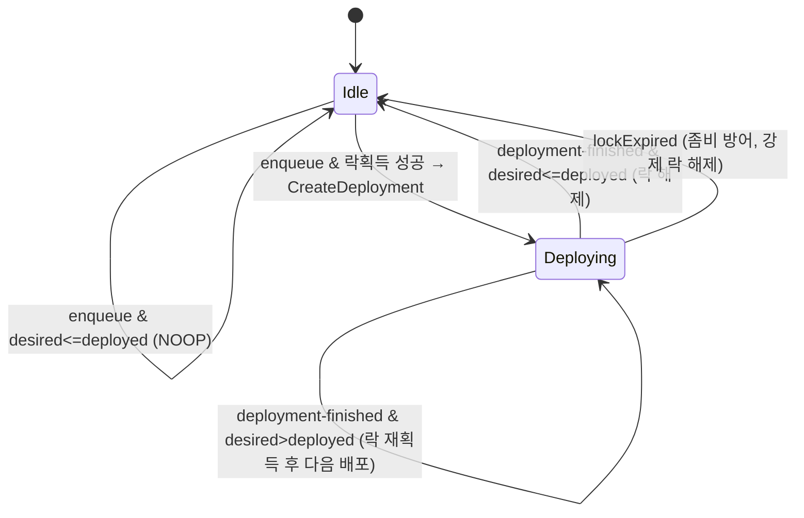

# 비동기 배포 드레이너 (Drainer) 설계 명세

## 1. 배경과 문제

현재 CI/CD는 GitHub Actions의 `deploy.mjs`가 **직접 `CreateDeployment`를 호출**해
CodeDeploy 배포를 트리거한다. 그런데:

- **CodeDeploy 하드 제약**: 배포 그룹당 활성 배포는 **1개**뿐이다. 진행 중 배포가 있으면 새
  `CreateDeployment`는 `DeploymentLimitExceededException`으로 **거부**된다. 진행 중 배포를
  자동으로 덮어쓰는(preempt) 기능은 **없다**.
- 유일한 "덮어쓰기" 경로는 `StopDeployment` 후 재배포인데, **Canary 전환 중 stop**은 alias가
  두 버전으로 분할된 채 고착돼 **이후 배포까지 막는** 위험이 있다(AWS 공식 문서 경고). `url`
  함수는 Canary 전략이라 이 리스크에 직접 노출된다. → **stop/덮어쓰기는 채택하지 않는다.**
- `url`의 Canary 1회는 약 **30분**. 따라서 "CI 잡이 배포 완료까지 블로킹 대기"하는 방식은
  러너 분(minutes)을 과도하게 소비하고 비블로킹 설계 철학과 어긋나 **기각**한다.

**해법**: 배포 트리거를 CI에서 떼어내 **이벤트 기반 드레이너 Lambda**로 옮긴다. CI는
DynamoDB 큐에 "원하는 버전(desiredVersion)"만 적재하고 즉시 종료한다. 드레이너가 큐를
소비하며 배포 그룹당 1개 제약을 지켜 순차 배포한다. 이로써 **유실 0 + 러너 대기 0 + 완전
비동기**를 동시에 달성한다.

### 유실이 없는 이유 (coalescing)

연속 머지가 쌓여 중간 버전을 건너뛰고 최신(`desiredVersion`)만 배포하더라도, **각 머지는
이미 자기 코드를 S3에 올리고 Lambda 버전으로 `publish`**한다. 최신 버전은 그간의 코드
변경을 누적 포함하므로, "중간 버전을 배포하지 않음"은 **코드 유실이 아니다**. (단, "모든
커밋이 각각 Canary를 통과해야 한다"는 요구가 있다면 coalescing 대신 순차 전부 배포로
바꿔야 하고, 그 경우 적체가 쌓인다. 현재 설계는 **coalescing을 채택**한다.)

---

## 2. 아키텍처 개요

```
머지 → CI(deploy.mjs 축소판): S3 업로드 + 버전 publish + DDB에 desiredVersion 기록
                                              │ (enqueue)
                                              ▼  DynamoDB Streams
                                        ┌───────────────┐
         EventBridge                    │               │
   (CodeDeploy 상태변경, dequeue) ─────▶ │  드레이너      │
                                        │  Lambda        │
                                        └───────┬───────┘
                                                │ 슬롯 비었을 때만(조건부 락)
                                                ▼
                                        CreateDeployment
                                                │
                                                ▼
                                        CodeDeploy 30분 Canary → SUCCESS/FAILURE/STOP
                                                │ EventBridge
                                                └──────────────▶ (드레이너 다시 깨어남, 다음 배포)
```

핵심: **DynamoDB 한 행이 "큐 + 분산 락 + 멱등 저장소" 세 역할을 동시에** 한다.

### 상태 머신



---

## 3. DynamoDB 테이블 설계 — `DeployQueue`

관심사 분리를 위해 애플리케이션 테이블(`UrlShortener`)과 **별도 테이블**을 권장한다.
함수(= 배포 그룹)당 **한 행**으로 상태를 관리한다.

| 속성 | 타입 | 예시 | 의미 |
| --- | --- | --- | --- |
| `PK` (파티션키) | S | `FN#urlshortener-url` | 함수(배포 그룹) 단위 격리. 함수당 1행. |
| `desiredVersion` | S | `"47"` | **큐**: 배포돼야 할 최신 Lambda 버전. enqueue가 덮어씀(coalescing). |
| `desiredS3VersionId` | S | `"abc123..."` | 그 버전에 대응하는 S3 오브젝트 버전(추적/멱등 보조). |
| `inFlightDeploymentId` | S | `"d-XXXXXXXXX"` | **락**: 진행 중 CodeDeploy 배포 ID. 존재 = 슬롯 점유 중. |
| `deployedVersion` | S | `"46"` | 마지막으로 성공 배포된 버전. |
| `lockExpiresAt` | N | `1760000000` | 락 TTL(epoch 초). 좀비 배포 방어. DDB TTL 속성으로 지정. |
| `updatedAt` | S | ISO-8601 | 관측/디버깅용. |

- **큐 = `desiredVersion`**: 여러 enqueue가 와도 최신으로 수렴.
- **락 = `inFlightDeploymentId`**: 조건부 쓰기(`attribute_not_exists`)로만 세팅 → 리더 선출.
- **TTL = `lockExpiresAt`**: 배포 최대시간(30분) + 여유 → **약 45분**. 드레이너가
  `CreateDeployment` 후 죽어 dequeue 이벤트를 영영 못 받으면 락이 영구 점유되는데, TTL
  만료 락은 다음 드레이너가 강제 해제 후 재평가한다. EventBridge 이벤트 유실 대비 안전망.

> DynamoDB Streams를 켜고(`NEW_AND_OLD_IMAGES`) 드레이너의 enqueue 트리거로 쓴다(아래 5절).
> 드레이너가 상태를 쓸 때(락 획득/배포ID 기록/해제 등)도 Streams 이벤트가 나므로, normalize는
> `OldImage.desiredVersion == NewImage.desiredVersion`인 MODIFY(= 드레이너 자기 쓰기)를 걸러
> 자기 재호출 증폭 루프를 막는다. 즉 "desiredVersion 변경"만 enqueue로 본다.

---

## 4. 드레이너의 의사결정 코어 — `decideNextAction` (순수 함수)

AWS 호출과 **분리**해 단위 테스트로 불변식을 증명한다. (이 리포의 `rebuildCounters`가
"부작용 없는 순수 재구성 함수를 테스트로 정합성 증명"하는 것과 동일한 철학.)

### 시그니처

```
decideNextAction({
  eventType,              // "enqueue" | "deployment-finished"
  desiredVersion,         // string | undefined
  deployedVersion,        // string | undefined
  inFlightDeploymentId,   // string | undefined  (락)
  finishedDeploymentId,   // string | undefined  (deployment-finished 이벤트의 배포 ID)
  now,                    // epoch 초
  lockExpiresAt,          // number | undefined
}) → { action: "DEPLOY" | "RELEASE_THEN_DEPLOY" | "RELEASE" | "NOOP", version? }
```

### 규칙

1. **락 점유 중 + enqueue 이벤트** → `NOOP`.
   (슬롯이 차 있으니 아무것도 안 함. `desiredVersion` 갱신은 enqueue 쓰기에서 이미 반영됨.)
   단, 락이 TTL 만료(`lockExpiresAt < now`)면 좀비로 간주해 `RELEASE_THEN_DEPLOY` 평가로 진입.
2. **deployment-finished 이벤트**:
   - `finishedDeploymentId`가 `inFlightDeploymentId`와 **일치할 때만** 락을 해제한다
     (엉뚱한 배포 이벤트 무시 — 멱등).
   - 락 해제 + `deployedVersion ← 방금 끝난 버전` 후, `desiredVersion > deployedVersion`이면
     `RELEASE_THEN_DEPLOY`, 아니면 `RELEASE`.
3. **enqueue 이벤트 + 락 없음 + `desiredVersion > deployedVersion`** → `DEPLOY`.
   (슬롯이 비어 있어 즉시 배포 시작.)
4. 그 외 → `NOOP`.

### 증명해야 할 네 불변식 (단위 테스트)

- **멱등성(idempotency)**: 같은 이벤트가 두 번 와도 상태 전이는 한 번만. 중복
  deployment-finished → 두 번째는 `finishedDeploymentId != inFlightDeploymentId`라 `NOOP`.
- **경쟁/리더 선출(race)**: `DEPLOY` 결정 후 조건부 락 획득에 실패하면 `NOOP`로 흡수(아래 5절).
- **수렴(coalescing)**: 적체된 여러 목표 중 최신(`desiredVersion`)만 `DEPLOY`.
- **dequeue**: 배포 종료 이벤트로 깨어나, 다음 목표가 있으면 `RELEASE_THEN_DEPLOY`.

---

## 5. 부작용 처리 (경쟁 안전) — 드레이너 핸들러

`decideNextAction`이 `DEPLOY`(또는 `RELEASE_THEN_DEPLOY`)로 결정하면, **실제 배포 전에 락을
조건부로 획득**해야 두 드레이너가 동시에 쏘는 걸 막는다.

```
1. DDB UpdateItem (조건부 락 획득):
     Key: { PK: "FN#<function>" }
     UpdateExpression:  SET inFlightDeploymentId = :newId, lockExpiresAt = :exp
     ConditionExpression: attribute_not_exists(inFlightDeploymentId)
                          OR lockExpiresAt < :now           // 좀비 락 탈취 허용
   → ConditionalCheckFailed 면 "이미 누가 점유" → NOOP (멱등 흡수)

2. 조건 통과 시에만:
   2a. (executed_version 모드) PutMetricAlarm 으로 롤백 알람을 신버전 기준으로 갱신
       ── 반드시 CreateDeployment "직전"에 수행 (6절).
   2b. GetAlias 로 현재 alias 버전을 읽어 appspec 구성 (CurrentVersion → TargetVersion).
   2c. CreateDeployment 호출. 반환된 deploymentId 를 inFlightDeploymentId 에 반영.

3. CreateDeployment 가 그래도 DeploymentLimitExceededException 이면
   (락과 실제 상태의 찰나 불일치) → 락 롤백 or 다음 이벤트에 위임(멱등하게 무시).
```

> **순서가 핵심**: "조건부 락 획득 → (알람 갱신) → CreateDeployment". 먼저 슬롯을 조건부로
> 잡고, 잡은 자만 배포한다 = 리더 선출.

---

## 6. 알람 갱신 소유권 이전 (중요 — 놓치기 쉬움)

현재 코드 리포의 `deploy.mjs`는 `errors_alarm_mode == "executed_version"`(= `url`, Canary)
함수에 대해 **CreateDeployment 직전에** 롤백 알람을 신버전 기준으로 갱신한다. 배포 트리거가
드레이너로 이동하므로 **이 알람 갱신 로직도 드레이너로 함께 이동해야 한다.** CI에는 남기지
않는다. 그래야 "배포 직전, 신버전(ExecutedVersion) 기준"이라는 타이밍 불변식이 유지된다
(CodeDeploy가 배포 중 이 알람을 감시하므로 반드시 CreateDeployment 이전에 갱신).

드레이너가 수행할 `PutMetricAlarm`(upsert, 통째 덮어쓰기):

```
PutMetricAlarm({
  AlarmName: <errors_alarm_name>,
  Namespace: <error_namespace>,
  MetricName: <error_metric_name>,
  Statistic: "Sum",
  ComparisonOperator: "GreaterThanOrEqualToThreshold",
  Threshold: <alarm_threshold ?? 3>,
  Period: <alarm_period ?? 180>,
  EvaluationPeriods: 1,
  TreatMissingData: "notBreaching",
  Dimensions: [
    { Name: "FunctionName",    Value: <function> },
    { Name: "Resource",        Value: "<function>:<alias>" },
    { Name: "ExecutedVersion", Value: <newVersion> },   // 신버전만 집계
  ],
  AlarmActions: [<notify_topic_arn>],
  OKActions:    [<notify_topic_arn>],
})
```

- `errors_alarm_mode == "alias"`(= `auth`, AllAtOnce)는 **알람 갱신 없음** — Terraform 정적
  알람을 그대로 쓴다.
- 핸들러가 try/catch로 예외를 삼키고 500을 리턴하면 AWS/Lambda `Errors`가 0이라 롤백이 안
  걸린다. 그래서 핸들러는 커스텀 메트릭(`PutMetricData`)을 발행하고(이 리포의
  `src/lib/metrics.mjs`), 롤백 알람은 그 커스텀 네임스페이스/지표를 본다.

### 드레이너가 필요로 하는 함수별 배포 설정 (Terraform 소유)

코드 리포의 축소된 `DEPLOY_MAP`에서 **빠진** 필드들은 드레이너 측 설정으로 이동한다:

| 필드 | 의미 |
| --- | --- |
| `function` | Lambda 함수명 |
| `alias` | 배포 alias (기본 `live`) |
| `codedeploy_app` | CodeDeploy 애플리케이션명 |
| `codedeploy_group` | CodeDeploy 배포 그룹명 |
| `errors_alarm_mode` | `executed_version` \| `alias` |
| `errors_alarm_name` | (executed_version) 갱신 대상 알람명 |
| `notify_topic_arn` | (executed_version) SNS 통지 토픽 |
| `error_namespace` | (executed_version) 커스텀 메트릭 네임스페이스 |
| `error_metric_name` | (executed_version) 커스텀 지표명 |
| `alarm_threshold` | (executed_version) 임계값(기본 3) |
| `alarm_period` | (executed_version) 평가 주기 초(기본 180) |

---

## 7. 두 트리거

### 트리거 A — enqueue (슬롯 비면 즉시 배포)

CI가 `desiredVersion`을 DDB에 쓴 직후 드레이너를 깨운다.

- **DynamoDB Streams (권장)**: `DeployQueue` 테이블에 Streams를 켜고 드레이너를 이벤트
  소스로 연결. CI는 DDB 쓰기만 하면 되어 느슨하게 결합된다. 이 리포가 이미 (조회수) Streams
  전환을 염두에 둔 설계라 일관성이 있다.
- 대안(직접 Invoke): CI가 `lambda:InvokeFunction`으로 드레이너 호출. 단순하지만 CI에
  권한·결합이 추가된다. **비권장.**

### 트리거 B — dequeue (앞 배포 끝나면 다음) — 필수

**EventBridge 규칙**으로 CodeDeploy 상태변경을 구독한다.

```json
{
  "source": ["aws.codedeploy"],
  "detail-type": ["CodeDeploy Deployment State-change Notification"],
  "detail": {
    "state": ["SUCCESS", "FAILURE", "STOP"],
    "deploymentGroup": ["<관리 대상 배포 그룹들>"]
  }
}
```

> 규칙을 관리 대상 배포 그룹(`deploymentGroup`)으로 한정해, 계정의 무관한 CodeDeploy 상태변경에
> 드레이너가 반응하지 않게 한다. CodeDeploy 상태변경 이벤트 detail의 실제 필드명은
> `deploymentGroup` / `deploymentId` / `application` / `state`다(`deploymentGroupName`이 아니다).

→ 드레이너를 타깃으로 연결. 이벤트의 배포 ID/그룹으로 "어떤 함수의 어떤 배포가 끝났는지"
식별한다. 이 트리거가 없으면 큐가 영영 비워지지 않는다(dequeue의 심장).

---

## 8. Terraform 리포가 소유할 자원

- `aws_dynamodb_table.deploy_queue` (Streams 활성 `NEW_AND_OLD_IMAGES`, TTL 속성 `lockExpiresAt`)
- `aws_lambda_function.deploy_drainer` (핸들러 코드 포함)
- `aws_lambda_event_source_mapping` (DeployQueue Streams → 드레이너)  ← 트리거 A
- `aws_cloudwatch_event_rule` + `aws_cloudwatch_event_target` (CodeDeploy 상태변경 → 드레이너) ← 트리거 B
- `aws_lambda_permission` (EventBridge → 드레이너 invoke 허용)
- **드레이너 IAM 역할** 권한:
  - `codedeploy:CreateDeployment`, `codedeploy:RegisterApplicationRevision`, `codedeploy:GetDeployment`, `codedeploy:ListDeployments`
  - `lambda:GetAlias`
  - `cloudwatch:PutMetricAlarm`  (executed_version 모드)
  - `dynamodb:UpdateItem`, `dynamodb:GetItem`  (DeployQueue)
  - DynamoDB Streams 읽기(`GetRecords`/`GetShardIterator`/`DescribeStream`/`ListStreams`)
  - CloudWatch Logs 기본 권한

---

## 9. 리포 간 계약 (Contract)

- **코드 리포(CI)가 쓰는 것** — `DeployQueue` 아이템에 대해:
  ```
  UpdateItem Key={ PK: "FN#<function>" }
    SET desiredVersion = <publish된 신버전>,
        desiredS3VersionId = <S3 오브젝트 버전>,
        updatedAt = <ISO-8601>
  ```
  그 외 속성(`inFlightDeploymentId`, `deployedVersion`, `lockExpiresAt`)은 **건드리지 않는다.**
- **드레이너가 소유하는 것**: 락(`inFlightDeploymentId`), `deployedVersion`, `lockExpiresAt`,
  CreateDeployment, GetAlias, PutMetricAlarm(알람 갱신), appspec 구성.
- **IAM 분담**: 코드 리포의 OIDC 배포 역할에서 `codedeploy:*`·`cloudwatch:PutMetricAlarm`·
  `lambda:GetAlias`를 **제거**하고 `dynamodb:UpdateItem`(DeployQueue 한정)을 **추가**한다.
  `s3:PutObject`(아티팩트)와 `lambda:UpdateFunctionCode`(publish)는 유지.

---

## 10. 좀비/장애 방어 요약

- **락 TTL**: EventBridge 이벤트 유실·드레이너 중도 사망 대비. 만료 락은 다음 드레이너가 탈취.
- **멱등 재확인**: dequeue 시 이벤트의 배포 ID가 `inFlightDeploymentId`와 일치할 때만 락 해제.
- **DeploymentLimitExceeded 흡수**: 락은 잡았으나 AWS가 아직 '진행 중'인 찰나 → 짧은 지수
  백오프 또는 다음 이벤트에 위임. 멱등하게 무시.
